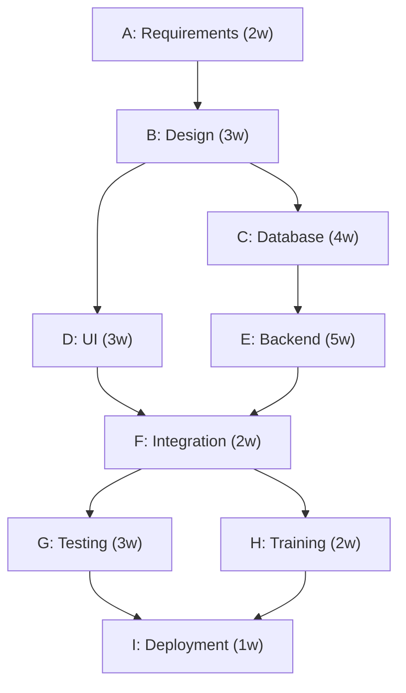

# IT3120 – Structured & Essay Answers + Reusable Reference Patterns

**Model End-Semester Examination | Part B Only | Questions 26–28 | 50 Marks**  
**Language:** Simple English | **Purpose:** Exam answers and compact reference-sheet patterns

> **Exam writing rule:** Answer the exact question. Match the number of points to the marks, use facts from the case, and show formula → substitution → answer → interpretation for calculations. The templates are guides, not guaranteed marking schemes.

---

# PART 1 — MODEL EXAM ANSWERS

## Question 26 — IT Project Management (20 Marks)

**Case:** Digital Student Services Management System. Budget = Rs. 20 million; planned implementation = 8 months; hybrid approach; proposed AI chatbot is outside approved scope.

### (a) Activity-on-Node (AON) Network Diagram — 5 Marks

**Activity data**

| Activity | Work | Duration (weeks) | Predecessor(s) |
|---|---|---:|---|
| A | Requirements analysis | 2 | None |
| B | System design | 3 | A |
| C | Database development | 4 | B |
| D | User interface development | 3 | B |
| E | Backend development | 5 | C |
| F | Integration | 2 | D, E |
| G | System testing | 3 | F |
| H | User training/documentation | 2 | F |
| I | Deployment/acceptance | 1 | G, H |



**Exam line:** This AON network shows all nine activities, durations and Finish-to-Start dependencies.

### (b) Critical Path and Project Duration — 5 Marks

**Formulas:** `EF = ES + Duration`; `ES = max(EF of predecessors)`; first activity starts at time 0.

| Activity | Duration | ES | EF |
|---|---:|---:|---:|
| A | 2 | 0 | 2 |
| B | 3 | 2 | 5 |
| C | 4 | 5 | 9 |
| D | 3 | 5 | 8 |
| E | 5 | 9 | 14 |
| F | 2 | 14 | 16 |
| G | 3 | 16 | 19 |
| H | 2 | 16 | 18 |
| I | 1 | 19 | 20 |

**Key forward-pass calculations:**
- A: `EF = 0 + 2 = 2`.
- B: `EF = 2 + 3 = 5`.
- C: `EF = 5 + 4 = 9`; D: `EF = 5 + 3 = 8`.
- E: `EF = 9 + 5 = 14`.
- F: `ES = max(8, 14) = 14`; `EF = 14 + 2 = 16`.
- G: `EF = 16 + 3 = 19`; H: `EF = 16 + 2 = 18`.
- I: `ES = max(19, 18) = 19`; `EF = 19 + 1 = 20`.

**Critical path:** **A → B → C → E → F → G → I**.  
**Minimum completion time:** `2 + 3 + 4 + 5 + 2 + 3 + 1 = 20 working weeks`.

**Exam conclusion:** The project network has a minimum duration of **20 working weeks** (assuming the given dependencies and no resource constraints). The case's eight-month implementation target is separate from this network calculation.

### (c) Float and Schedule Control — 3 Marks

**Formulas:** `LS = LF − Duration`; `LF = min(LS of successors)`; `Total Float = LS − ES = LF − EF`.

| Activity | ES | EF | LS | LF | Total Float |
|---|---:|---:|---:|---:|---:|
| D | 5 | 8 | 11 | 14 | **6 weeks** |
| H | 16 | 18 | 17 | 19 | **1 week** |

- D must finish by week 14 for F, so `TF(D) = 14 − 8 = 6 weeks`.
- H must finish by week 19 for I, so `TF(H) = 19 − 18 = 1 week`.

**Exam explanation:** Total float is the time an activity can be delayed without delaying the overall project finish. Float helps managers prioritize critical tasks and control schedule delays. Critical activities usually have zero total float.

### (d) Earned Value Management (EVM) — 4 Marks

**Given:** `PV = Rs. 10m`, `EV = Rs. 8m`, `AC = Rs. 9m`.

| Metric | Formula and calculation | Answer |
|---|---|---|
| CV | `EV − AC = 8 − 9` | **−Rs. 1m** |
| SV | `EV − PV = 8 − 10` | **−Rs. 2m** |
| CPI | `EV / AC = 8 / 9` | **0.89** |
| SPI | `EV / PV = 8 / 10` | **0.80** |

**Exam interpretation:** The project is **over budget** (`CV < 0`, `CPI < 1`) and **behind schedule** (`SV < 0`, `SPI < 1`). Note: EVM schedule variance is expressed in budget-value units, not weeks.

### (e) Scope and Integration Management — 3 Marks

1. **Assess impact:** Evaluate the AI chatbot's effect on scope, cost, schedule, resources and integration with existing student-system modules.
2. **Control change:** Prepare a formal change request, review options and obtain approval **before** adding the chatbot.
3. **Update and integrate:** If approved, update the scope, cost and schedule baselines; plan development, integration and testing with existing modules.

**Exam note:** An unapproved addition may cause scope creep. Approval makes it a controlled scope change.

---

## Question 27 — ICT Entrepreneurship (15 Marks)

**Case:** AgriConnect Lanka; farmer–buyer marketplace; low digital literacy, existing supplier relationships, unreliable delivery; available Rs. 2m versus Rs. 3.5m full application (excluding marketing and operations); pilot proposed in one district.

### (a) Opportunity and Feasibility — 4 Marks

1. **Technical feasibility:** Build a simple, mobile-friendly app with listings and order requests. Design it for users with low digital literacy.
2. **Market feasibility:** Test demand among farmers and local restaurants. Existing supplier relationships may slow buyer adoption.
3. **Operational feasibility:** Arrange reliable deliveries and provide user training or support for farmers.
4. **Financial feasibility:** Rs. 2m is not enough for the Rs. 3.5m full app, even before marketing and operations. Start with an affordable district pilot or seek more funding.

### (b) Lean Startup and MVP — 4 Marks

**Lean Startup** tests business ideas using **Build → Measure → Learn**, with minimal resources and real customer feedback.

**Three MVP features:**
1. **Product listings:** Farmers post products, quantities and prices.
2. **Buyer search:** Buyers find available products and prices.
3. **Order requests:** Buyers send basic orders to farmers.

**Feedback use:** Pilot the app in one district, gather farmer and buyer feedback, fix usability/order issues and improve features before expansion.

### (c) Startup Risks — 4 Marks

| Risk | One mitigation |
|---|---|
| Low digital literacy | Provide training and an easy-to-use interface. |
| Low buyer adoption | Run a pilot, demonstrate benefits and offer trial incentives. |
| Unreliable delivery | Partner with reliable local delivery services. |
| Insufficient funding | Launch a low-cost MVP and control spending. |

### (d) Business Model and Growth — 3 Marks

1. **Target market:** Small farmers and local restaurants in one district.
2. **Value proposition:** Easy market access, transparent prices and direct farmer–buyer connections.
3. **Scaling strategy:** Expand district by district after pilot results show demand and reliable operations; earn revenue from commissions and premium buyer subscriptions.

---

## Question 28 — Legal and Ethical Issues (15 Marks)

**Case:** SmartRecruit AI; biased recruitment scores; third-party code with unchecked licence; applicant records exposed to staff without business need; unrelated marketing use proposed without telling applicants.

### (a) Legal Issues — 4 Marks

1. **Data protection:** Access by employees without business need risks exposing applicant personal data and violating applicable privacy obligations.
2. **Copyright and software licensing:** Unchecked third-party code may breach copyright or licence terms.
3. **AI discrimination:** Unequal candidate scores may create discriminatory recruitment decisions and potential legal/regulatory risks.
4. **Data purpose and transparency:** Using applicant data for unrelated advertising without proper notice and a valid legal basis may breach data-protection requirements.

**Use careful language:** These are **potential legal issues**, not confirmed legal violations based on the case alone.

### (b) Privacy and Access Control — 4 Marks

1. **RBAC and least privilege:** Allow access only to employees who need applicant information for their work.
2. **Encryption:** Encrypt applicant data at rest and in transit.
3. **MFA and audit logs:** Strengthen sign-in security and review access activity.
4. **Data minimization and retention:** Collect only needed data, define retention periods and securely delete outdated records.

### (c) Ethical Responsibilities — 4 Marks

1. **Fairness:** Audit AI data and scores for bias against applicant groups.
2. **Correct bias:** Improve training data, evaluate the model and retest outcomes.
3. **Human oversight:** Let responsible staff review significant recruitment decisions and challenges.
4. **Responsible data use:** Stop unrelated marketing use until proper notice and a valid legal basis are in place; be transparent with applicants.

### (d) Professional Ethics and Governance — 3 Marks

1. **Public interest:** Protect applicants from unfair treatment and privacy harm.
2. **Professional competence and responsibility:** Check code licences, test AI fairness and maintain secure software.
3. **Integrity and confidentiality:** Be honest about system risks and restrict access to personal records.

**Reference caution:** These are practical ethical duties relevant to the case. If your course requires the *exact wording or numbering* of the CSSL Code of Ethics, use the official wording from your lecture/code material.

---

# PART 2 — REUSABLE FILL-IN-THE-BLANKS ANSWER PATTERNS

Replace `[ ... ]` with **facts from the actual exam case**. These are reusable patterns, not replacements for reading the question.

## Pattern 1 — Feasibility (4 Marks)

1. **Technical:** The project can be developed using `[technology / solution]`; the main challenge is `[technical constraint]`.
2. **Market:** Target customers are `[customers]`; demand must be validated because `[market challenge]`.
3. **Operational:** The company should arrange `[people / training / delivery / support]` to operate the solution.
4. **Financial:** The available budget is `[amount]` compared with the estimated cost of `[amount]`; therefore `[pilot / reduce scope / seek funding]` is recommended.

## Pattern 2 — Lean Startup and MVP (4 Marks)

**Definition:** Lean Startup uses **Build → Measure → Learn** to test assumptions with low cost.

1. MVP feature: `[essential feature 1]`.
2. MVP feature: `[essential feature 2]`.
3. MVP feature: `[essential feature 3]`.
4. Feedback: Collect `[survey / interview / usage]` feedback from `[target users]` and improve `[main problem]` before scaling.

## Pattern 3 — Risk + Mitigation (4 Marks)

Use **four case-specific pairs**:

| Risk sentence | Mitigation sentence |
|---|---|
| `[Risk 1]` may cause `[impact]`. | Reduce it by `[action]`. |
| `[Risk 2]` may cause `[impact]`. | Reduce it by `[action]`. |
| `[Risk 3]` may cause `[impact]`. | Reduce it by `[action]`. |
| `[Risk 4]` may cause `[impact]`. | Reduce it by `[action]`. |

Useful matches: low adoption → pilot/trials; insufficient funds → MVP/cost control; technical defects → testing; low skills → training; delivery failures → logistics partners.

## Pattern 4 — Business Model and Growth (3 Marks)

1. **Target:** Initially target `[specific users]` in `[location]`.
2. **Value:** Solve `[customer problem]` by offering `[main benefit]`.
3. **Growth:** Test a pilot, measure `[adoption / sales / reliability]` and expand to `[new market]` when results are positive.

## Pattern 5 — Legal Issues (4 Marks)

1. **Privacy:** `[data access / storage / processing]` may create data-protection risks because `[reason]`.
2. **Copyright/licence:** Use of `[third-party code]` requires compliance with `[licence conditions]`.
3. **Fairness:** `[AI / decision process]` may discriminate against `[affected users]`.
4. **Purpose/transparency:** Using `[personal data]` for `[new purpose]` requires appropriate notice and a valid legal basis.

## Pattern 6 — Privacy & Security Controls (4 Marks)

1. Apply **RBAC and least privilege** to restrict `[sensitive data]` to authorized staff.
2. Use **encryption** to protect `[data]` in transit and at rest.
3. Use **MFA and audit logs** for sensitive access and monitoring.
4. Apply **data minimization and retention rules** to avoid unnecessary storage.

## Pattern 7 — Ethical Responsibilities (4 Marks)

1. **Fairness:** Audit `[system]` for bias and unequal outcomes.
2. **Correction:** Improve `[data / model / process]` and retest.
3. **Accountability:** Use human oversight for `[important decisions]`.
4. **Privacy/transparency:** Explain `[data use / automated decision]` and prevent unauthorized use.

## Pattern 8 — Professional Ethics (3 Marks)

1. **Public interest:** Protect `[users]` against `[harm]`.
2. **Competence/responsibility:** Test and maintain `[system]` and follow `[standards/licences]`.
3. **Integrity/confidentiality:** Report problems honestly and protect `[confidential information]`.

## Pattern 9 — Scope Change / Integration (3 Marks)

1. **Analyze:** Evaluate `[new feature]` impact on scope, schedule, cost, resources and dependencies.
2. **Approve:** Submit a change request and obtain authorization before development.
3. **Implement:** After approval, update plans/baselines and integrate/test `[feature]` with `[existing modules]`.

## Pattern 10 — CPM Network and Timing (Calculation Pattern)

1. Draw one **node per activity** with its duration.
2. Connect every **predecessor → successor**.
3. **Forward pass:** `ES(first)=0`; `ES=max(predecessor EF)`; `EF=ES+duration`.
4. **Backward pass:** `LF(last)=project finish`; `LF=min(successor LS)`; `LS=LF−duration`.
5. **Total float:** `TF=LS−ES=LF−EF`.
6. **Critical path:** longest duration path through the network; zero-float activities normally lie on a critical path.
7. **Conclusion:** “The critical path is `[activities]` and minimum duration is `[time units]`.”

## Pattern 11 — Earned Value Management (Calculation Pattern)

| Metric | Formula | Exam interpretation |
|---|---|---|
| PV | Budgeted value of scheduled work | Work planned by review date |
| EV | Budgeted value of completed work | Work actually earned |
| AC | Actual cost incurred | Actual spending |
| CV | `EV−AC` | Negative = over budget |
| SV | `EV−PV` | Negative = behind schedule |
| CPI | `EV/AC` | Below 1 = cost inefficiency |
| SPI | `EV/PV` | Below 1 = behind schedule |
| EAC | `BAC/CPI` | Forecast if current cost efficiency continues |

**Exam sentence:** “The project is `[over/under]` budget because CV is `[value]` and CPI is `[value]`. It is `[ahead/behind]` schedule because SV is `[value]` and SPI is `[value]`.”

---

# PART 3 — ULTRA-COMPACT REFERENCE SHEET

```text
PART B: 50 marks | Q26 PM 20 | Q27 Entrepreneurship 15 | Q28 Legal/Ethics 15

Q26: AON=nodes + all predecessor arrows.
CPM: EF=ES+dur; ES=max(pred EF); LF=min(successor LS); LS=LF-dur.
TF=LS-ES=LF-EF; critical path=longest path (normally zero TF).
MODEL: critical A-B-C-E-F-G-I = 20 weeks; D TF=6w; H TF=1w.
EVM: CV=EV-AC; SV=EV-PV; CPI=EV/AC; SPI=EV/PV.
MODEL: CV=-1m, SV=-2m, CPI=.89, SPI=.80 => over budget + late.
SCOPE CHANGE: assess impact -> formal approval -> update baselines + integrate/test.

Q27 FEASIBILITY: Technical / Market / Operational / Financial + case evidence.
LEAN STARTUP: Build-Measure-Learn; MVP=3 essential features; use feedback.
RISKS: 4 actual case risks + one mitigation each.
BUSINESS: Target customer/location + value proposition + pilot-then-scale.

Q28 LEGAL: Privacy / code licensing / AI discrimination / data-purpose transparency.
PROTECTION: RBAC least privilege / encryption / MFA+logs / minimization+retention.
ETHICS: Audit bias / correct model / human review / lawful transparent data use.
PROFESSIONAL: Public interest / competence / integrity + confidentiality.

MARKS RULE: 3 marks ~ 3 case-specific points; 4 marks ~ 4 clear points.
ANSWER STYLE: Action + why + case fact. Calculations: formula -> numbers -> result -> meaning.
```

**Scope:** Structured/essay only. No multiple-choice answers included.
